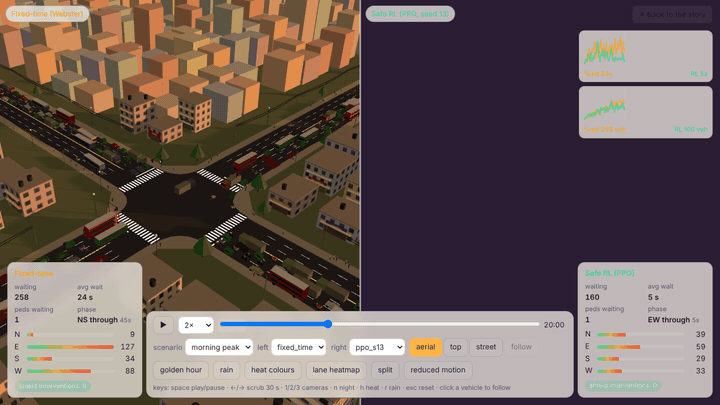
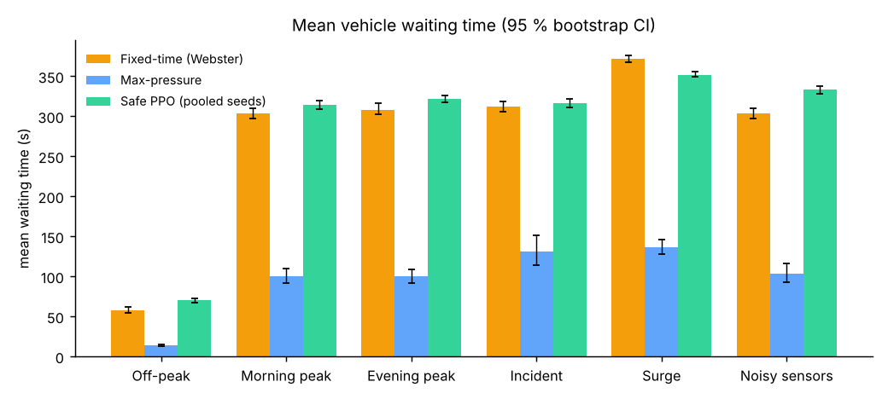
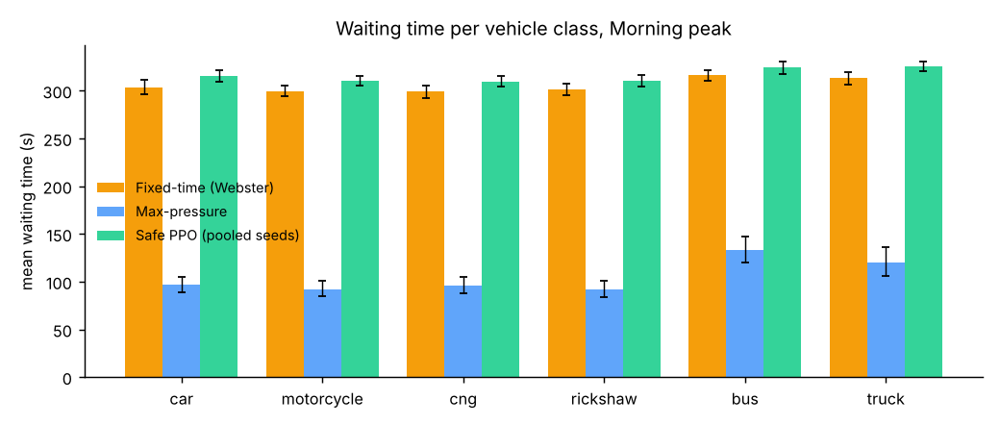
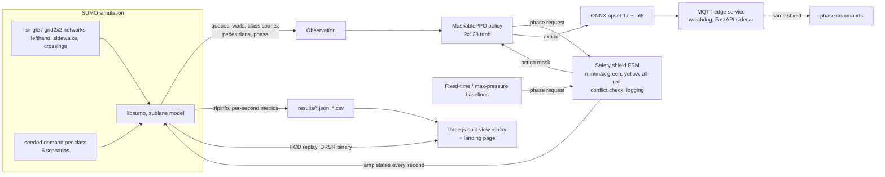

<!-- This file is RENDERED from docs/templates/README.md.in by `make docs`; edit the template, not this file.
     Every number below is read from results/ (see scripts/render_docs.py and scripts/check_numbers.py). -->

<p align="center">
  
</p>

# Safe Deep RL Traffic Signals for Dhaka-like Mixed Traffic

[](https://github.com/minus69to/Hobby-Traffic/actions/workflows/ci.yml)
[](https://github.com/minus69to/Hobby-Traffic/actions/workflows/pages.yml)
[](LICENSE)

A reinforcement-learning traffic-signal controller for the kind of traffic Dhaka has: buses, cars,
motorcycles, CNG auto-rickshaws, slow cycle-rickshaws and pedestrians sharing and weaving between
lanes at a signalised junction. A MaskablePPO policy is trained in SUMO (sublane model, left-hand
traffic) and is **safe by construction**: an action mask keeps it from choosing anything the signal
timing rules forbid, and an explicit runtime safety shield (a finite-state machine every controller
passes through) inserts yellow and all-red, enforces minimum and maximum greens and rejects
conflicting greens. The result is evaluated against a Webster fixed-time plan and a max-pressure
controller across six demand scenarios, exported to int8 ONNX, wrapped in an MQTT edge service, and
visualised as a split-screen 3D replay.

**Live demo:** https://minus69to.github.io/Hobby-Traffic/ (GitHub Pages, see
[deployment](#github-pages-deployment)). **Report:** [docs/report.md](docs/report.md).

> Everything here is a **synthetic simulation study**. Demand volumes, the vehicle mix and all vehicle
> parameters are assumptions inspired by Dhaka traffic, not measurements. No real-world data was used
> and no real-world validation is claimed.

## Headline results

Morning peak, 10 evaluation episodes of 3600 s per controller and
scenario on seeds disjoint from training, 95 % paired-bootstrap confidence intervals. "Safe PPO" pools
the trained seeds (13, 42). Generated by `make eval` into `results/eval_summary.json`.

| Metric (morning peak) | Fixed-time (Webster) | Max-pressure | Safe PPO | PPO vs fixed-time [95 % CI] |
|---|---|---|---|---|
| Mean vehicle waiting time (s) | 303.3 | 100.4 | 314.1 | +3.6% [+0.4%, +7.0%] |
| 95th percentile travel time (s) | 1133.6 | 491.0 | 1064.3 | -6.1% [-9.2%, -2.5%] |
| Mean queue (vehicles) | 269.4 | 240.8 | 256.0 | -4.9% [-6.8%, -3.1%] |
| Throughput (vehicles completed) | 2706 | 2683 | 2484 | -8.2% [-9.5%, -7.0%] |
| Pedestrian mean wait (s) | 17.5 | 4.5 | 10.5 | -39.7% [-41.7%, -37.7%] |
| Rickshaw mean wait (s) | 301.2 | 91.8 | 310.8 | +3.2% |
| Bus mean wait (s) | 316.1 | 133.5 | 324.6 | +2.7% |
| Shield interventions per episode | 0.00 | 0.00 | 0.00 | reported even when zero |
| Phase switches per hour | 87 | 206 | 182 | |

**What the numbers say.** The synthetic peaks are oversaturated (a share of
0.29 of the vehicles does not finish within the
hour even under fixed-time, and insertion delays are several minutes), so waiting-time means of
completed trips must be read together with throughput and `mean_depart_delay` in
`results/main_table.csv`. With this CPU budget the safe PPO policy does **not** beat the baselines on
vehicle delay: max-pressure is clearly best on waiting time in every scenario, and PPO lands close to
fixed-time (seed 13 slightly better, seed 42 worse). PPO does cut pedestrian waiting
(-39.7% in the morning peak) and the shield never had
to intervene. The contribution of this repository is the safety construction, the mixed-traffic
simulation and the reproducible pipeline, not a performance claim; see `docs/report.md` section 6.

Mean waiting time, change of Safe PPO vs fixed-time per scenario (95 % CI):
off-peak +20.3% [+10.8%, +28.5%],
morning peak +3.6%,
evening peak +4.4% [+1.5%, +7.2%],
incident +1.5% [-1.1%, +3.8%],
surge -5.2% [-6.8%, -3.5%],
noisy sensors +9.9% [+7.2%, +12.6%].
Full table: [`results/main_table.csv`](results/main_table.csv); figures in [`figures/`](figures/).

<p align="center">
  <br>
  
</p>

**Edge export** (`make export`, `results/edge_benchmark.json`): float ONNX 101.9 kB,
int8 ONNX 31.5 kB; action agreement int8 vs float 99.51%
and float vs PyTorch 100.00% on 10,000 random observations;
single-thread CPU latency int8 p50 0.012 ms, p95 0.016 ms
over 10,000 calls (an approximation of a small edge CPU, not a Jetson measurement).

**Training** (`make train`): 2 seeds (13, 42; the third seed of the plan did not
train, see `DECISIONS.md` 12) x 300,000 environment steps on 4 CPU cores, 112 min per seed on average (45.7 env steps/s).
Simulation speed: 101 SUMO steps/s per process with the sublane model and pedestrians.

## Architecture



## How safety is guaranteed

1. **Action masking** (sb3-contrib `MaskablePPO`): a phase change is invalid before `min_green`
   (10 s), forced after `max_green` (60 s), and impossible during yellow, all-red or the pedestrian
   walk minimum (8 s). The policy never samples an invalid action, during training or deployment.
2. **Runtime safety shield** (`src/drs/shield.py`): an explicit finite-state machine
   `GREEN(p) -> YELLOW(3 s) -> ALL_RED(2 s) -> GREEN(q)` that every controller (PPO, both baselines and
   the MQTT service) passes through. It rejects phase requests that violate the timers, rejects any
   state with conflicting protected greens (using the conflict matrix read from the SUMO network),
   forces a change after `max_green` even if the controller is silent, and logs every intervention
   with time and reason. Interventions are reported in every results table, even when zero.
3. **Tests** (`tests/test_shield.py`): unit tests for every rule plus `hypothesis` property tests that
   generate random action sequences and timing parameters and assert that no conflicting greens ever
   appear, every green lasts between the minimum and maximum, and every switch goes through the full
   yellow + all-red clearance.

## How to run

```bash
make setup        # Python venv (SUMO, SB3, torch CPU, ...) and web dependencies
make networks     # netconvert builds sim/networks/*.net.xml from plain XML
make demand       # seeded route files for every scenario and seed
make test         # ruff/mypy are `make lint`; unit + property tests
make train        # MaskablePPO, 3 seeds, logs to logs/ and models/single/<seed>/tb
make eval         # 10 episodes x 6 scenarios x all controllers -> results/
make report       # figures/ from results/
make replay       # synchronised replays for the web app (web/public/data/replays)
make export       # ONNX + int8 + benchmark -> results/edge_benchmark.json
make web          # build the static site into web/dist
make docs         # render README.md and docs/report.md from the templates and results/
make check-numbers
make reproduce    # ~15 minute small-budget end-to-end run (networks, demand, short training, mini eval)
docker compose up # broker + controller service + SUMO bridge + static site (not executed in the dev VM)
```

The MQTT loop can also be run without Docker: start `mosquitto`, then
`make service` and `python -m drs.service.bridge --scenario morning_peak --seconds 300`.
The integration test (`pytest -m integration`) does exactly that for 5 simulated minutes; its last
run exchanged 300 commands over 300 simulated seconds with 0 missed deadlines.

## Project structure

```
configs/        sim.yaml (networks, vehicle types, mix, scenarios, seeds), train*.yaml, eval*.yaml, service.yaml
sim/            networks (plain XML + built .net.xml), vtypes/dhaka.add.xml, demand/ (generated, git-ignored)
src/drs/        topology, netbuild, demand, signal (phase tables), shield, sumo_sim, env, vec_env,
                controllers/ (fixed_time, max_pressure, ppo/onnx), train, evaluate, metrics, replay,
                export_onnx, service/ (schemas, core, app, sidecar, bridge)
scripts/        speedtest, export_geometry, make_replay, make_figures, capture_media, render_docs, check_numbers, gen_certs
tests/          unit, property-based (hypothesis), slow SUMO smoke tests, MQTT integration test
web/            Vite + React + TypeScript + three.js split-view replay and landing page
results/        eval_summary.json, main_table.csv, edge_benchmark.json, training_summary.json, speedtest.json
figures/ docs/  generated figures, report, media, citation log, GitHub workflow copies
models/final/   final small policy files (SB3 zip + VecNormalize stats + ONNX)
```

## GitHub Pages deployment

`.github/workflows/pages.yml` builds `web/` with the repository name as base path and deploys it with
`actions/deploy-pages`. One manual step is needed once: repository **Settings -> Pages -> Source:
"GitHub Actions"**. GitHub Pages needs a public repository on the free plan.

## Limitations

- **Synthetic demand inspired by Dhaka.** Volumes, turning ratios, the vehicle mix and all vehicle
  parameters (`configs/sim.yaml`) are assumptions; nothing was calibrated against real counts.
- **No real-world data or validation**, no field deployment, no claim of transfer to real signals.
- **CPU training budget**: 300,000 steps per seed; longer training and a wider hyper-parameter
  search were out of budget.
- **Simplified pedestrians**: SUMO's striping model at signalised crossings only; no jaywalking.
- **Gridlock prevention settings** (`--ignore-junction-blocker 30`, pedestrian jam time 60 s) are
  needed for the sublane + pedestrian combination; teleporting is disabled (see `DECISIONS.md`).
- The edge latency is measured in the development VM, not on a Jetson or similar device.

## Licence and citation

Code: MIT (see `LICENSE`). SUMO is EPL-2.0; three.js is MIT; Noto Sans Bengali is OFL.

```bibtex
@software{mandol2026dhakarlsignals,
  author = {Mandol, Souvik},
  title  = {Safe Deep RL Traffic Signals for Dhaka-like Mixed Traffic},
  year   = {2026},
  url    = {https://github.com/minus69to/Hobby-Traffic},
  note   = {Synthetic SUMO study; MaskablePPO with a runtime safety shield}
}
```
